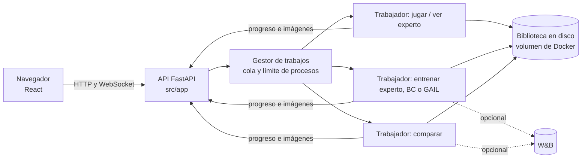
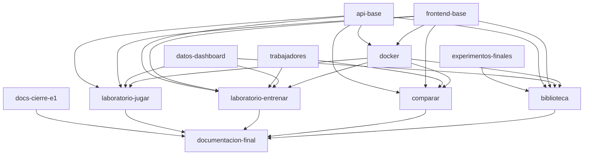

# Plan de la entrega final (E2)

Borrador del 2026-11-04, para revisar en equipo. Recoge las decisiones tomadas hasta
hoy y marca como **pendiente** lo que todavía no está decidido. Entrega: **4 de
diciembre de 2026**.

## 1. Qué sabemos de la entrega

| Parte | Lo que consta | Fuente |
|---|---|---|
| Aplicativo | 8 puntos de la E2 | Docstring de la plantilla (`src/app/serve.py`) |
| Bitácora de IA | 4 puntos de la E2 | `AI_USAGE.md` |
| Resultados y discusión | Los escribe el equipo, no la IA, y se comprueban en la defensa | `AI_USAGE.md` y `AGENTS.md` |
| Fecha | 4 de diciembre de 2026 | Equipo |
| Qué hay que entregar | Completar el aplicativo | Equipo |

## 2. Decisiones tomadas (2026-11-04)

| Tema | Decisión |
|---|---|
| Interfaz | React con JavaScript (Vite), con FastAPI de backend (ya fijado con WebSocket en `requirements.txt`) |
| Entornos | Los cinco. Jugar a mano y grabar demostraciones manuales, solo en CartPole y MountainCar; en los demás, las demostraciones se graban con el experto. El resto del dashboard funciona en los cinco |
| Dibujo del entorno | Imágenes renderizadas en el servidor (`rgb_array`) y enviadas al navegador |
| Entrenamientos | En procesos trabajadores aparte que llaman a las mismas funciones que los scripts; un modelo por ejecución, con todos los hiperparámetros editables. Ninguna funcionalidad se limita por ello (vista cambiable en marcha, pausar, reanudar, finalizar, checkpoints) |
| Vista durante el entrenamiento | Experto y GAIL: interruptor para dibujar en directo las partidas del propio entrenamiento, desactivado por defecto (solo curvas). BC: solo curvas, porque no juega partidas. BC y GAIL se ven jugar en «Comparar» |
| «Ver agente» del Laboratorio | Para el experto: verlo jugar y grabar demostraciones con él |
| Comparar | Visualización de las partidas opcional |
| Validación de BC | Reparto automático, con semilla, de partidas enteras de validación entre los datos elegidos |
| W&B | Opcional, con un interruptor; por defecto todo se guarda en local |
| Biblioteca inicial | Expertos y demostraciones congelados, más los BC y GAIL de los grupos de entrega de la E1 |
| Concurrencia | Varias ejecuciones a la vez |
| Despliegue | Docker en local |
| Tests | Backend (pytest y cliente de pruebas de FastAPI), frontend (Vitest y Testing Library) y de punta a punta (Playwright) |
| Plantilla del aplicativo | Se sustituye: fuera `serve.py`, `ModeloPlaceholder`, `construir_modelo` y la sección `modelo`, con sus tests |
| Manejo de Docker | Un Taskfile con las tareas habituales (construir, arrancar, parar, tests, logs…) |
| Precarga de la biblioteca | Se descarga de W&B al arrancar por primera vez (el profesor tiene acceso al proyecto) |
| Regla 5/20 y T4 | Se justifica en el README que todo corre en CPU |
| Pausar, reanudar y finalizar | Se mantienen, con checkpoints para retomar una ejecución cortada (sección 3) |
| Trabajos a la vez | Como mucho `experimento.procesos` |
| Partidas por defecto | Las de la E1: 50 por modelo al comparar y las del perfil al grabar con el experto; editables desde la interfaz. Al jugar a mano, las que quiera el jugador, hasta que pare |
| Velocidad al jugar a mano | ×1: la del propio entorno (`render_fps`: 50 en CartPole, 30 en MountainCar) |
| Documento técnico | Lo edita el equipo en Google Drive, fuera del repositorio |
| Reparto entre Asier e Ibon | **Pendiente**: se decide más adelante |

Pendientes de la E1 que entran en la E2: recortar el README, destacar el enlace al
proyecto de W&B, ampliar el documento técnico (paper, arquitectura, diferencias y un
apartado del aplicativo), ejecutar los experimentos de Reacher y HalfCheetah, generar
un experimento nuevo de CartPole con nombre coherente (grupo `entrega-e1-cartpole`,
conservando `entrega-e1`), limpiar W&B (artefactos antiguos de Windows) y dejar el
hueco de «Resultado» para el equipo.

## 3. Arquitectura propuesta

- **Todo lo que crea entornos o modelos corre en un proceso trabajador aparte**
  (`multiprocessing` con `spawn`, como el barrido de la E1): jugar, ver al experto,
  entrenar y comparar. Un único mecanismo para todo.
  - Cada trabajador llama a **las mismas funciones que los scripts**
    (`entrenar_y_guardar_experto`, `entrenar_y_guardar_bc`, `entrenar_y_guardar_gail`,
    la evaluación), así que entrena lo mismo que la E1. Los scripts siguen existiendo
    para la línea de comandos.
  - La API no importa `src/training`: el trabajador lo importa dentro del proceso
    hijo. Se cumple la separación de la plantilla.
  - Los ajustes de la interfaz llegan como una capa de configuración
    (`resolver_configuracion(..., ajustes)`) y se guardan en los metadatos del modelo.
- **Comunicación con cada trabajador**, por colas (`multiprocessing.Queue` o `Pipe`):
  - *Órdenes* (API → trabajador): encender o apagar la vista, finalizar, guardar
    checkpoint y, en las sesiones, las teclas. El trabajador las lee entre pasos.
  - *Progreso* (trabajador → API): medidas de cada iteración o época.
  - *Imágenes* (trabajador → API): JPEG, solo con la vista encendida, en una cola
    propia para que no retrasen el progreso.
  - *Pausar y reanudar*: `SIGSTOP`/`SIGCONT` al proceso del trabajador, exacto.
  - Si un trabajador muere sin avisar (por ejemplo, por falta de memoria), su trabajo
    cuenta como fallido y el resto sigue, como en el barrido de la E1.
- **Vista que se puede cambiar en marcha**: Gymnasium no deja cambiar el modo de
  dibujo de un entorno ya creado, así que uno de los entornos paralelos se crea
  siempre con `render_mode="rgb_array"` y solo se llama a `render()` con la vista
  encendida. Un test comprueba que el modelo final sale igual sin vista, con vista y
  encendiéndola y apagándola a mitad.
- **Gestor de trabajos**: cola, cancelación y estado de cada trabajo, con
  `experimento.procesos` procesos a la vez como mucho, para que cada uno tenga un
  núcleo. Las sesiones de juego y de ver al experto también cuentan.
- **Biblioteca**: índice de modelos y demostraciones con sus metadatos y huellas,
  guardado en el volumen de Docker.
- **Procedencia dentro de Docker**: la imagen no lleva `.git`, así que `estado_git`
  no podría leer el commit; hay que pasarlo al construir la imagen.
- **Pausar, reanudar y finalizar** (confirmado):
  - *Pausar y reanudar*: el gestor detiene el proceso y lo reanuda tal cual
    (`SIGSTOP`/`SIGCONT`). Es exacto: el modelo final sale igual que sin pausa.
  - *Finalizar antes de tiempo*: se para y se guarda el modelo de ese momento,
    marcado como incompleto en sus metadatos.
  - *Ejecución cortada* (se cierra el contenedor o se cae el proceso): cada trabajo
    guarda un checkpoint periódico en una carpeta aparte de la biblioteca (por
    ejemplo `en_curso/<trabajo>/`) y se puede reanudar desde el último. En BC basta
    con modelo, optimizador y estado de la parada temprana. En el experto y GAIL
    hacen falta también la red de valor, el discriminador con su optimizador, la
    normalización y los generadores aleatorios. Aun así, los entornos quedan a
    mitad de partida, así que **un entrenamiento reanudado no saldrá idéntico** al
    que no se corta. Se marca como «reanudado» en sus metadatos, y para los
    resultados del experimento se usan solo ejecuciones sin cortes.
- **Partidas configurables**: los valores de la E1 vienen por defecto y la interfaz
  los cambia con la misma capa de ajustes que los hiperparámetros. Una comparación
  con otro número de partidas u otras semillas guarda su protocolo, porque no es
  comparable con la de la E1.

## 4. Ramas

Cada rama sale de `main`, se revisa en pareja con la plantilla del PR y lleva sus tests.
Las de la fase 2 incluyen backend, frontend y pruebas de punta a punta de su parte.

### Fase 0 · Cierre de la E1 (en paralelo con todo lo demás)

**1. `docs-cierre-e1`**: documentación pendiente de la E1.
- Recortar el README: una lista de recortes que revisa el equipo antes de aplicarla.
- Enlace al proyecto de W&B más visible.
- Regla 5/20 y T4: justificar que todo corre en CPU (`device="cpu"`), que una GPU no
  lo acelera y que los tiempos son los medidos en CPU; no se ha medido en Colab.
- Hueco «Resultado» marcado para el equipo.
- Hecho cuando: el README está revisado por los dos y el checker sigue en 100/100.

**2. `experimentos-finales`**: los experimentos que faltan, sin cambiar código.
- CartPole en el grupo nuevo `entrega-e1-cartpole`, y Reacher y HalfCheetah en
  `entrega-e1-reacher` y `entrega-e1-halfcheetah`.
- Lanzarlos desde un commit limpio en una copia aparte (`git worktree`), para poder
  seguir programando en la principal sin marcar sus modelos «con cambios sin commit».
- Borrar de W&B los artefactos antiguos de Windows.
- Tiempos, grupos y runs de comparación en el README (medidos, no estimados).
- Hecho cuando: los tres experimentos terminan con código 0 y el README cita sus grupos.

### Fase 1 · Bases

**3. `api-base`**: esqueleto del backend.
- Sustituye la plantilla (`serve.py`, `ModeloPlaceholder`, `construir_modelo`,
  sección `modelo`) por la aplicación FastAPI en `src/app/`.
- Gestor de trabajos (cola, límite, cancelación, estado) y protocolo de progreso con
  los procesos.
- Índice de la biblioteca y lectura de los metadatos que ya guardan expertos,
  demostraciones, BC y GAIL.
- Interruptor de W&B.
- Tests: rutas, cola y límite, cancelación, errores.

**4. `frontend-base`**: esqueleto del frontend.
- React con JavaScript y Vite en una carpeta propia (por ejemplo `web/`), servido por
  FastAPI en producción.
- Pestañas Laboratorio, Comparar y Biblioteca, selector de entorno, cliente HTTP y de
  WebSocket.
- Configuración de Vitest, Testing Library y Playwright.

**5. `trabajadores`**: el entrenamiento y la evaluación, controlables desde fuera.
- Trabajadores de experto, BC, GAIL y comparación que llaman a las funciones de los
  scripts, con su capa de ajustes (todos los hiperparámetros).
- Puntos de enganche en los bucles de entrenamiento para progreso, órdenes e imágenes
  sin cambiar lo que calculan.
- Checkpoints periódicos y reanudación (sección 3).
- Entrenamiento de un solo BC o GAIL con los datos elegidos, además del barrido.
- Vista del entrenamiento opcional y cambiable en marcha (experto y GAIL), con un
  test de que no cambia el modelo final.
- Test de regresión: los scripts y los trabajadores dan los mismos resultados que la
  E1 con los datos congelados.

**6. `datos-dashboard`**: los datos que crea el dashboard.
- `combinar_demostraciones`: varios NPZ en uno nuevo con IDs sin repetir antes de
  crear los splits (decisión del 2026-10-13).
- Subconjuntos por partidas y por tramos de pares; los pares repetidos cuentan una vez.
- Metadatos para demostraciones humanas: hoy `guardar_demostraciones` exige los datos
  de un experto.
- Reparto automático de partidas de validación entre los datos elegidos.
- Tests: huellas, IDs, tramos no válidos, combinaciones vacías.

### Fase 2 · Funcionalidades

**7. `docker`**: imagen y arranque.
- Dockerfile en varias etapas (compilar el frontend y luego el entorno de Python),
  `docker compose` con el volumen de la biblioteca y el puerto.
- `Taskfile.yml` (go-task, con la versión fijada en el README) con las tareas de
  construir, arrancar, parar, ver logs, abrir una terminal en el contenedor, lanzar
  los tests (backend, frontend y de punta a punta), el smoke y la descarga de la
  biblioteca a mano.
- Render sin pantalla de MuJoCo dentro del contenedor (Reacher y HalfCheetah).
- Commit de git dentro de la imagen para la procedencia.
- Clave de W&B como variable de entorno, nunca dentro de la imagen.
- Qué se versiona: `Dockerfile`, `compose.yaml`, `.dockerignore` y `Taskfile.yml`
  van al repositorio, porque son la receta. Las imágenes, los contenedores y el
  volumen no: cada uno los construye en su máquina con el Taskfile. `.dockerignore`
  deja fuera de la imagen `data/`, `checkpoints/`, `wandb/`, `.venv/` y la clave.
- Precarga: al arrancar por primera vez, si el volumen está vacío y hay clave, se
  descargan de W&B los congelados y los BC y GAIL de los grupos de entrega,
  comprobando sus huellas (como `run.py --descargar`). Sin clave o sin acceso, el
  dashboard arranca con la biblioteca vacía y lo avisa; la tarea de descarga del
  Taskfile permite repetirla.
- Test: el smoke y un trabajo corto dentro del contenedor.

**8. `laboratorio-jugar`**: «Jugar tú» y «Ver agente».
- Trabajador por sesión (sección 3), que cuenta para el límite de procesos.
- Jugar con el teclado en CartPole y MountainCar. En CartPole, que no tiene acción de
  «no hacer nada», el entorno se para mientras no haya ninguna tecla pulsada y sigue
  al volver a pulsar. En MountainCar, sin tecla se usa su acción de no acelerar
  (**pendiente de confirmar**).
- «Ver agente»: el experto estocástico, como al grabar en la E1; cada partida con su
  semilla, anotada en los metadatos.
- Ver al experto jugar en los cinco entornos.
- Grabar, revisar qué partidas y pares guardar, y guardarlos en la biblioteca.
- Velocidad ×1, la del entorno. Partidas por sesión: al grabar con el experto, las
  del perfil; al jugar a mano, las que quiera el jugador, hasta que pare.

**9. `laboratorio-entrenar`**: «Entrenar experto» y «Entrenar e imitar».
- Experto, BC y GAIL desde la interfaz, con todos los ajustes y los datos elegidos.
- Curvas en directo; dibujo opcional del entrenamiento para experto y GAIL.
- Pausar, reanudar y finalizar, y retomar desde el último checkpoint (sección 3).
- El modelo entrenado se guarda en la biblioteca; W&B opcional.

**10. `comparar`**: la pestaña Comparar.
- Varios modelos con las mismas partidas y semillas, visualización opcional.
- 50 partidas por modelo por defecto (protocolo de la E1), editable; pausar,
  reanudar y finalizar.
- Resultados provisionales mientras evalúa, media ± desviación y puntuación por partida.
- Guardar el resultado e historial de entrenamiento de cada modelo.

**11. `biblioteca`**: la pestaña Biblioteca.
- Listado de modelos y demostraciones con sus metadatos.
- Creación de subconjuntos (interfaz de lo hecho en `datos-dashboard`).
- Precarga de congelados y de los BC y GAIL de los grupos de entrega.

### Fase 3 · Cierre

**12. `documentacion-final`**
- README de la E2: cómo arrancar con Docker y cómo usar el dashboard.
- Documento técnico ampliado (paper, arquitectura, diferencias y un apartado del
  aplicativo): lo edita el equipo en Google Drive; aquí solo se actualiza el PDF de
  `docs/` si se quiere versionar.
- `AGENTS.md` y `AI_USAGE.md` al día.
- «Resultado» y la discusión: los escribe el equipo.

## 5. Calendario propuesto

Cuatro semanas hasta el 4 de diciembre. Es una propuesta para ajustar al reparto.

| Semana | Ramas |
|---|---|
| 4–10 nov | `docs-cierre-e1`; lanzar `experimentos-finales` (corre en paralelo); `api-base`, `frontend-base`, `trabajadores` y `datos-dashboard` |
| 11–17 nov | `docker` (probar pronto el render de MuJoCo) y `laboratorio-jugar` |
| 18–24 nov | `laboratorio-entrenar`, `comparar` y `biblioteca` |
| 25 nov–1 dic | Integración, pruebas de punta a punta en Docker y `documentacion-final` |
| 2–4 dic | Margen para fallos y entrega |

## 6. Riesgos

| Riesgo | Por qué importa | Mitigación propuesta |
|---|---|---|
| Render de MuJoCo sin pantalla en Docker | Sin él no se ven Reacher ni HalfCheetah | Probarlo pronto, en la rama `docker` |
| La vista en directo ralentiza el entrenamiento | Dibujar cuesta tiempo | Desactivada por defecto; dibujar un solo entorno de los paralelos |
| Que la vista cambie el resultado | Rompería la reproducibilidad | Test de pesos idénticos con y sin vista |
| Memoria con varios trabajos a la vez | Unos 830 MB por proceso en CartPole y unos 590 MB más en MuJoCo; el portátil tiene unos 7,6 GB en WSL | Límite de `experimento.procesos`; límite de memoria del contenedor; un trabajador que muere cuenta como fallido y no tumba a los demás |
| Hilos de más (PyTorch, NumPy/BLAS) | Cada biblioteca puede abrir varios hilos y romper la regla de un núcleo por proceso | `torch.set_num_threads(1)` en cada trabajador, como el barrido, y `OMP_NUM_THREADS=1` y `MKL_NUM_THREADS=1` en el contenedor |
| Escrituras a la vez en la biblioteca | Dos trabajos que terminan a la vez podrían pisar el índice | Escribir cada modelo en su carpeta nueva con renombrado al final (`escribir_carpeta_nueva`) y reconstruir el índice leyendo las carpetas, sin un archivo común que editar |
| Imágenes que se acumulan | Si el navegador va más lento que el trabajador, la cola crece | Cola de imágenes de tamaño 1: se envía siempre la última y se descartan las viejas |
| Tiempos con otros trabajos en marcha | Compartir CPU y memoria no cambia el resultado, pero sí cuánto tarda | Guardar en los metadatos cuántos trabajos había a la vez; medir los tiempos del README sin otros trabajos |
| Experimentos de la E1 y dashboard a la vez | Los experimentos de `experimentos-finales` ya usan 5 procesos | No lanzar trabajos pesados del dashboard mientras corren |
| Experimentos de MuJoCo de horas | Bloquean el portátil | Copia aparte y lanzarlos pronto |
| Clave de W&B | No puede ir en el código ni en la imagen | Variable de entorno; W&B desactivado por defecto |

## 7. Preguntas abiertas

1. Qué se recorta del README: se hablará más adelante.
2. Reparto de ramas entre Asier e Ibon: más adelante.
